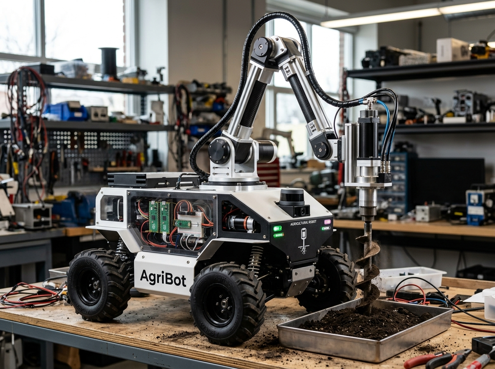

# 🌾 AgriBot — 6-DOF Agricultural Mobile Robot & Embedded Robotics Suite
### **Grant-Funded Flagship Robotics Project &bull; Er. Vishnu Ramachandra (10th VTU Rank)**
*Embedded Robotics &bull; Mechatronics &bull; Raspberry Pi Pico &bull; ESP32-CAM &bull; Autodesk Fusion 360 &bull; Micro-Actuator Drivers*

[-10B981?style=for-the-badge)](https://vishuu77.github.io/)
[](https://vishuu77.github.io/)
[](https://vishuu77.github.io/)
[](https://vishuu77.github.io/)
[](https://vishuu77.github.io/)
[](https://vishuu77.github.io/)

---

## 📸 AgriBot Flagship Showcase

<div align="center">
  
  <p><em>AgriBot 6-Degree-of-Freedom agricultural robot engineered for automated sapling plantation and high-precision vertical soil drilling. Seed-funded by SRPP 2025–26 and honored at 59th Engineers' Day by IEI Karnataka.</em></p>
</div>

---

## 🏛️ Executive Summary

**AgriBot** is a grant-funded 6-Degree-of-Freedom mobile robotics platform designed to automate physical sapling plantation, depth-controlled vertical soil drilling, and field navigation.

- **Awarded Competitive Seed Grant:** Selected under the **Student Research Project Programme (SRPP 2025–26)**.
- **State-Level Recognition:** Honored at the **59th Engineers' Day** by **The Institution of Engineers (India) - Karnataka State Centre**.
- **Inventor & Lead Architect:** **Er. Vishnu Ramachandra** (10th University Rank across Visvesvaraya Technological University in Robotics & AI, 9.11 CGPA Honours).

---

## 🛠️ Mechatronic & Embedded Architecture

| Subsystem | Components & Hardware | Functional Role |
| :--- | :--- | :--- |
| **Real-Time Control** | Raspberry Pi Pico (Dual-Core ARM Cortex-M0+) | Motor PWM sequencing, closed-loop current stall detection & limit switch interrupts. |
| **Visual Telemetry** | ESP32-CAM (OV2640 Wi-Fi Video Streamer) | Real-time terrain viewing, row alignment visual cues & remote telemetry dashboard. |
| **Vertical Drill** | Johnson 12V 500RPM DC Motor + M8 Lead-Screw | 220mm vertical guide-rail penetration stroke; automatic peck-drill retract on root stall. |
| **Mobile Drivetrain** | 4WD DC Geared Motors (150RPM, 130mm AT Wheels) | Differential skidding drive navigating plowed furrow agricultural terrain. |
| **Power Distribution** | 12V 7.2Ah LiFePO4 + 20A BMS + LM2596 Buck | 4.5 hours continuous field operation with low-voltage protection cutoffs. |

---

## 📂 Repository Structure

```
RAI-/
├── assets/
│   └── agribot_showcase.jpg             # High-resolution photographic showcase of AgriBot
├── firmware/
│   ├── pico_drill_controller.py         # MicroPython motor driver, current sense & limit switches
│   ├── esp32cam_telemetry.ino           # ESP32-CAM Wi-Fi streaming & visual alignment firmware
│   ├── ultrasonic_depth_profiler.py     # Ground referencing algorithm replacing expensive IMU drift
│   └── agentic_motor_sequencer.py       # Autonomous multi-phase plantation state machine
├── cad_specifications/
│   ├── agribot_6dof_kinematics.json     # Kinematic coordinates, lead-screw stroke & drivetrain specs
│   └── chassis_mounting_specs.md        # Autodesk Fusion 360 aluminum square tubing specs & dampers
├── hardware_schematics/
│   └── pinout_wiring_diagram.md         # Interconnect schematic between Pico, ESP32-CAM, BTS7960 & Battery
├── docs/
│   ├── srpp_grant_technical_report.md   # SRPP 2025–26 grant technical documentation & IEI award citation
│   └── bill_of_materials.csv           # Complete component hardware list & procurement specs
└── README.md
```

---

## 🚀 Running AgriBot Simulation & Tests

### 1. Test Ultrasonic Depth Profiler
```bash
python firmware/ultrasonic_depth_profiler.py
```

### 2. Run Agentic Plantation Loop Sequence
```bash
python firmware/agentic_motor_sequencer.py
```

---

## 🌐 Live Portfolio Reference

AgriBot is featured as **Flagship Case 01** in Er. Vishnu Ramachandra's Executive Portfolio:  
**Live Site:** [https://vishuu77.github.io/#projects](https://vishuu77.github.io/#projects)

---

&copy; 2026 Er. Vishnu Ramachandra &bull; 10th University Rank, Visvesvaraya Technological University (VTU)
